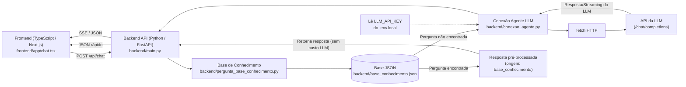

# ChatBot MS

Objetivo: criar uma conexão com os agentes IA para dar suporte para os cidadões e funcionários do Governo, API https://seu-servidor-llm.exemplo/v1

## Regras

1. **A API key nunca entra no git.** Ela fica só em `.env.local`, lida no servidor.
2. **Uma branch + um PR por etapa.** Nome: `feat/etapa-N-<slug>`. Commits em Conventional Commits (`feat:`, `fix:`, `docs:`, `chore:`).
3. **Sem dependência nova sem combinar antes.** `fetch` resolve 90% dos casos.
4. **Browser nunca chama a API da LLM direto.** Sempre passa por um proxy do seu backend (route handler, endpoint Flask, etc.) — é onde a key fica guardada.
5. **Documente enquanto implementa.** Doc feita depois nunca sai.

## Fluxo

## Arquitetura em Dois Pacotes

- **`backend/` (Python >=3.14 + FastAPI + Uvicorn)**:
  - `backend/main.py`: Roteador principal FastAPI com CORS, validação Pydantic e Streaming SSE.
  - `backend/pergunta_base_conhecimento.py`: Checagem e roteamento de perguntas frequentes.
  - `backend/conexao_agente.py`: Comunicação segura com a API do servidor Ollama com timeout de 60s.
  - `backend/base_conhecimento.json`: Perguntas e respostas pré-definidas (exemplos de serviços públicos).
  - `backend/requirements.txt`: Dependências Python.

- **`frontend/` (TypeScript >=5 + Next.js 16 + React 19)**:
  - `frontend/app/chat.tsx`: Interface do chat moderna com chips, streaming SSE, badges inteligentes e cópia.
  - `frontend/app/layout.tsx`: Layout da interface sem redirecionamentos externos.
  - `frontend/app/app.css`: Estilização refinada com dark/light mode nativo.
  - `frontend/app/api/chat/route.ts`: BFF proxy que repassa requisições para o backend FastAPI.

- Definições dos Agentes IAs [definicoes-agentes-ias.md](docs/definicoes-agentes-ias.md)
- Agentes do projeto em [`.claude/agents/`](.claude/agents/):
  - [`orchestrator.md`](.claude/agents/orchestrator.md): Coordenação geral e seleção de IA
  - [`backend-dev.md`](.claude/agents/backend-dev.md): Desenvolvimento no pacote `backend/`
  - [`frontend-dev.md`](.claude/agents/frontend-dev.md): Desenvolvimento no pacote `frontend/`
  - [`reviewer-poc-llm.md`](.claude/agents/reviewer-poc-llm.md): Validação de segurança e checklist
---

## Etapas

### Etapa 0 — Setup

- **Arquivos:** `requirements.txt`, `.env.example`, `.gitignore`.
- **Contrato:** `pip install -r requirements.txt` roda sem erro. `.env.example` lista as 3 variáveis sem valor.
- **Dicas:** key vem por canal privado (nunca commitada). Testar primeiro no Postman antes de escrever código.
- **Pronto quando:** `curl` direto na API da LLM (fora do app) devolve 200.

### Etapa 1 — Rota `app/src/html` (sem streaming)

- **Arquivos:** `app/src/html`
- **Contrato:** `html.py`  recebe `{ "messages": [...] }` e devolve `{ "content": "..." }`. Erro: `{ "error": "..." }` com status apropriado.
- **Dicas:** usar `requests.post` com `timeout=60`. Header: `Authorization: Bearer key`. Body: `{ "model": "qwen3.8:27b", "messages": [...], "stream": false }`. Ver `docs/02-api-openai-compativel.md` do poc-llm.
- **Pronto quando:** `curl -X POST localhost:5000/api/chat -d '{"messages":[{"role":"user","content":"oi"}]}'` devolve resposta do modelo.

### Etapa 2 — UI básica

- **Arquivos:** `templates/index.html`, `conexao-agente.py`, `static/style.css`, `static/chat.js`.
- **Contrato:** textarea + botão enviar + lista de bolhas (user / assistant). Enter envia, Shift+Enter quebra linha. Loading desabilita botão.
- **Dicas:** histórico é um `let messages = []` em JS. A cada envio, faz push e manda o array inteiro pro backend (modelo não tem memória).
- **Pronto quando:** conversa de 3+ turnos funciona e o modelo lembra o contexto anterior.

### Etapa 3 - Verificação da pergunta (Fase 2)

- **Arquivos:** `pergunta-base-conhecimento.py`
- **Contrato:** irá verificar se a pergunta do usuário é compatível com a base de conhecimento. Se for, irá retornar uma resposta pré-definida.
Dessa maneira quebrando o fluxo e economizando recursos do modelo de IA.
- **Dicas:** compatível com a base quer dizer que se a pergunta já estiver na base de conhecimento não iremos precisar acionar o modelo, por que
teremos a resposta já definida, e não precisaremos gastar recursos computacionais. Assim só acionamos o modelo em casos de perguntas mais complexas
ou que não estejam na base de conhecimento.
- **Pronto quando:** pergunta cadastrada na base retorna resposta fixa sem chamar o LLM; pergunta fora da base cai no fluxo da Etapa 1".

### Etapa 4 — Streaming (opcional/Fase 3)

- **Arquivos:** `app.py`, `conexao-agente.py`, `static/chat.js`.
- **Contrato:** backend repassa o stream SSE da API. Browser lê com `ReadableStream` e vai concatenando `delta.content`.
- **Dicas:** cuidado com chunks cortando no meio de uma linha `data:`. Use um buffer.
- **Pronto quando:** texto aparece aos poucos na tela.
---

## Armadilhas conhecidas

- `qwen3.8:27b` pode levar 30s+. Mostre loading, use timeout de 60s.
- `qwen3-embedding:8b` **não** conversa — é só pra embeddings. Esconda da UI.
- Nunca logue a key nem o header `Authorization`.

---
