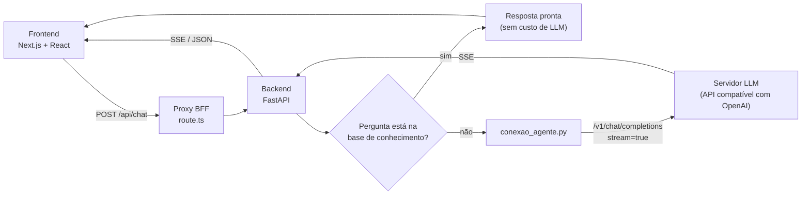

# Chat com LLM — base de conhecimento + streaming

Prova de conceito de um assistente de atendimento para serviços públicos. Antes de chamar a LLM, o back-end procura a pergunta numa base de conhecimento. Se encontrar, responde na hora e sem custo de tokens. Se não encontrar, repassa a conversa para um modelo de linguagem via API compatível com OpenAI e devolve a resposta em streaming (SSE).

> Projeto desenvolvido durante meu estágio de TI, com revisão de código do meu mentor. Esta é uma cópia pública sem dados internos: o endereço do servidor de LLM foi trocado por um exemplo e nenhuma chave de API faz parte do repositório.

## Arquitetura



- **A chave da API nunca chega ao navegador.** Só o back-end lê `LLM_API_KEY`.
- **Roteamento por base de conhecimento:** as perguntas e respostas frequentes ficam em `backend/base_conhecimento.json`. A busca normaliza o texto (acentos e pontuação) e compara palavras-chave.
- **Streaming (SSE):** o texto aparece enquanto o modelo gera.
- **Desenvolvimento com agentes de IA:** em [`.claude/agents/`](.claude/agents/) estão os agentes que usei para orquestrar o trabalho: orquestrador, back-end, front-end e revisor.

## Tecnologias

`Python` · `FastAPI` · `Pydantic` · `Uvicorn` · `Next.js 16` · `React 19` · `TypeScript` · `SSE` · `Ollama` · `API compatível com OpenAI` · `Postman`

## Rodar local

Requer Python 3.12+, Node 20+, pnpm e um servidor de LLM compatível com OpenAI (por exemplo, [Ollama](https://ollama.com) local).

```bash
cp .env.example .env.local      # preencha LLM_BASE_URL e LLM_API_KEY

# backend
pip install -r backend/requirements.txt
pnpm dev:backend

# frontend (outro terminal)
pnpm i
pnpm dev
```

- Chat: http://localhost:3000
- Docs: http://localhost:3000/docs

## Estrutura

```text
backend/
  main.py                       API FastAPI: roteador, CORS, validação e SSE
  pergunta_base_conhecimento.py busca na base de conhecimento
  conexao_agente.py             chamada à LLM (síncrona e streaming)
  base_conhecimento.json        perguntas e respostas de exemplo
frontend/
  app/chat.tsx                  interface do chat
  app/api/chat/route.ts         proxy BFF para o backend
  app/docs/                     renderiza docs/*.md
docs/                           documentação técnica
postman/                        collection para testar a API
```

## Documentação

1. [O que é uma LLM](docs/01-o-que-e-llm.md): tokens, contexto e temperatura, com testes de consumo de tokens
2. [API compatível com OpenAI](docs/02-api-openai-compativel.md)
3. [Modelos disponíveis](docs/03-modelos-disponiveis.md): comparativo com benchmark
4. [Streaming (SSE)](docs/04-streaming.md)
5. [Embeddings e RAG](docs/05-embeddings-e-rag.md)
6. [Arquitetura da POC](docs/06-arquitetura-da-poc.md): cotas de tokens e considerações para produção
7. [Tipos e escopo de chatbots](docs/chatbot-texto-corrigido.md)
8. [Definições dos agentes de IA](docs/definicoes-agentes-ias.md)

## Autor

**Antonio Sergio Santana Pecin** · [LinkedIn](https://www.linkedin.com/in/antonio-sergio-santana-pecin-56b41b449/) · [GitHub](https://github.com/AntonioPecin)
