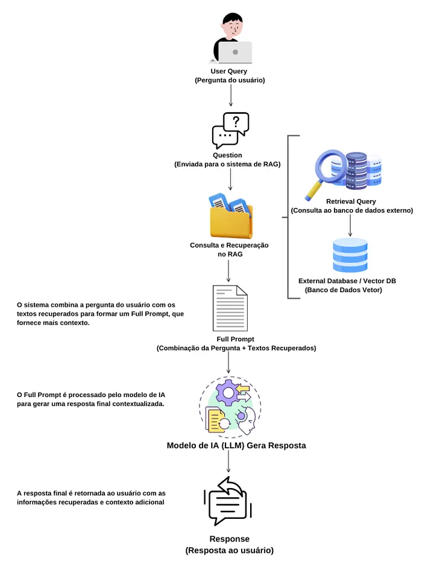

# Embeddings e RAG (Retrieval-Augmented Generation)

## O que é um embedding?
Um **embedding** é uma representação numérica de textos, palavras ou dados em um espaço vetorial de alta dimensão, permitindo que computadores capturem o significado semântico do conteúdo. 

Os modelos de embedding convertem textos em vetores matemáticos e, dependendo do modelo utilizado, suportam dimensões de saída configuráveis pelo usuário (por exemplo, variando de 32 a 4096 dimensões).

---

## Similaridade Semântica
A **similaridade de cosseno** é uma métrica amplamente utilizada no processamento de linguagem natural. Ela determina o quão similares dois vetores (textos) são com base na **direção** em que apontam no espaço vetorial, em vez de sua magnitude ou comprimento.

* **Exemplo de aplicação:** Duas frases com redações totalmente distintas — como *"Quero agendar uma consulta médica"* e *"Preciso marcar um horário com o doutor"* — possuem vetores apontando para direções quase idênticas porque compartilham a mesma intenção semântica.

---

## RAG em uma imagem

---

## Quando o RAG resolve?

* **Sem RAG:** A LLM tenta responder utilizando apenas os pesos estáticos aprendidos durante seu treinamento original. Se for questionada sobre informações privadas, dados em tempo real ou fatos fora de seu banco de conhecimento, ela tenta preencher as lacunas gerando textos estatisticamente plausíveis, o que frequentemente resulta em **alucinações** (fatos inventados com alta convicção).
* **Com RAG:** O sistema recupera trechos relevantes em um banco de dados externo (Vector DB) e os insere no prompt antes de enviar a requisição à LLM. Com isso, a tarefa do modelo deixa de ser "adivinhar" ou puxar da memória interna, passando a ser **ler, sintetizar e responder com base estrita no texto fornecido** (*grounding* ou ancoragem).